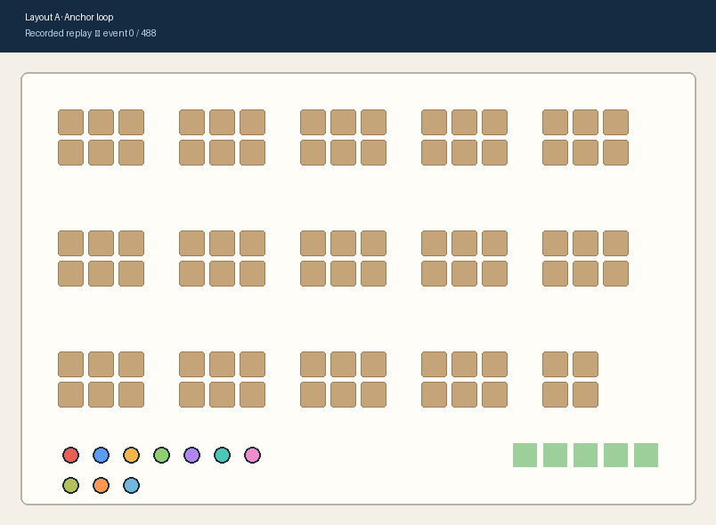
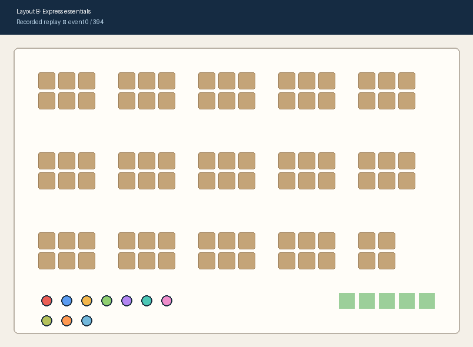

# Simply

A React/Next.js retail-layout lab backed by one Python simulation. The default
shopper model is **GPT-6 Luna** through OpenRouter, pinned to OpenAI’s standard endpoint. Direct OpenAI Responses remains available with `--provider openai`. The live lab also offers **GPT-6.1 Terra**
for model testing; Gemini is an explicit
optional provider. New live/model runs use Gary-2 style navigation assistance in Python: avoid repeated routes, collect reachable list items and steer toward checkout. Each model request proposes one action; recordings retain the original proposal and identify every adjustment. Python records the actions and results. React displays those
same records as shopper positions, baskets, routes, and analytics.

```text
React controls / Python command → model decisions → Python core commits
                                                        ├──→ live React stream
                                                        └──→ saved run → replay / evaluation
```

## Recorded demos

These previews use the same two completed, integrity-checked recordings featured
on the landing page. They replay saved Python events; they do not start a model
run or generate new shopper actions.

| Layout A — Anchor loop | Layout B — Express essentials |
| --- | --- |
| [](landing/public/replays/1512b82600664e66ae4db51c29841a6a.json) | [](landing/public/replays/1e5be585cfcd4d09bb198967c3281d79.json) |
| [Open the complete replay record](landing/public/replays/1512b82600664e66ae4db51c29841a6a.json) | [Open the complete replay record](landing/public/replays/1e5be585cfcd4d09bb198967c3281d79.json) |

New model runs use **two layouts (A and B)** and **10–15 shoppers**, defaulting to
10. Use `--shoppers 15` to select the larger cohort. Saved older recordings keep
their original inputs and counts.
New runs request each product once and finish payment with one checkout action.
Duplicate pickups are rejected. Shopper budgets are soft targets; overspending
is permitted and measured. The retained earlier recordings keep their original rules.

There is no separate browser shopping policy and no desktop app to launch.
This follows Gary-2's run → record → web replay pattern, with Simply's own UI,
record validation, and evaluation.

## Start the live web lab

For a fresh checkout, use Python 3.11+ and Node.js 22, then install locally:

```bash
python3 -m venv .venv
.venv/bin/python -m pip install -r requirements.txt
npm ci --prefix landing
```

The Python simulation uses the standard library and the repository's virtual
environment. Configure `OPENROUTER_API_KEY` (or the supported `OPEN_ROUTER_KEY` alias) in the local `.env` file (see
`.env.example`), then start these in two terminals:

```bash
npm run simulation:serve --prefix landing
npm run dev --prefix landing
```

Python listens only on loopback. The web app proxies live events and controls;
credentials stay in Python. Each run saves a unique JSONL recording throughout
execution. The headless command remains available:

```bash
.venv/bin/python simulation/main.py --provider openai --shoppers 10 --export-web
```

Open the product page at `http://localhost:3000` and the interactive lab at
`http://localhost:3000/lab`. In Live simulation, choose a layout and 10–15
shoppers, select Luna or Terra, then Start live run. The store preview makes no
model calls. Watch confirmed actions, inspect purchases in the decision feed, and use
Python pause/advance/resume/stop controls. After a run ends, save it to recorded
replays. The Recorded replays tab retains playback, seeking and inspection.
Playback, seeking and filtering cannot change the recorded outcome.

A missing API key aborts clearly. Existing recordings can still be viewed without
credentials. The site does not substitute synthetic decisions for missing evidence.

## Current validation and published evidence

Cross-runtime checks verify live/replay states, independent commits, reconnects,
source integrity, unique-product shopping, soft budgets and single-action checkout.
See the verification commands below for the current checks.

The October 29 model/layout experiment collected 80 attempted simulated trips:
seven complete ten-shopper runs and one interrupted run. OpenAI returned
`credit_balance_exhausted`; the interruption is retained and the planned
five-repetition study is explicitly incomplete. In two matched Layout A pairs,
Luna used 87.8% less estimated API cost per checkout than Terra, with 96.2%
versus 99.1% purchased-list fulfillment. These are exploratory assisted-system
observations, not population estimates or real retail impact.
See the [inspectable case study](landing/public/replays/matrix-48ea3402f27344af949f1002123fe826.md)
and [supported resume wording](simulation/docs/resume-evidence.md).

The original successful Layout A/B recordings remain unchanged. Newly authorized
study attempts and the separate complete-trip pilots are retained for verification;
older deleted archives were not restored. The API accounting ledger remains intact.
Scripted fixtures never stand in for model evidence.
See [the live implementation and Gary-2 reference](simulation/docs/gary2-live-reference.md).

The [implementation audit](simulation/docs/implementation-status.md) tracks the
current scope and the evidence still needed before the full plan is complete.

## Run history and comparisons

The Evidence page leads with four model/layout conditions, paired differences,
collection coverage and the provider interruption. Individual recordings,
diagnostics and full reports are collapsed. Python computes every outcome and
difference; React displays the saved values.

The local history refreshes every 15 seconds while the page is visible and makes
no model calls. An explicitly exported, integrity-checked history snapshot works
without the local Python service. Saving a replay updates its published summary;
export all retained summaries for a shareable snapshot with:

```bash
.venv/bin/python -m simulation.core.evidence --root simulation/runs --destination landing/public/replays
npm run verify:history --prefix landing
```

History comparisons flag different cohorts, products/prices, prompts, models,
engine versions, policies and settings. Unknown costs stay unknown; an unmatched
or single-run comparison is not presented as causal layout or retail impact.
See [run history and measurement details](simulation/docs/run-history.md).

## Saved evidence and terminal inspection

Runs are uniquely created under `simulation/runs/`. They contain the initial
inputs, ordered attempts, raw replies, before/after states, failures, telemetry,
and a recomputable summary. Completing a configured run does not imply that all
shoppers checked out; inspect the actual counts and stopping reasons.

```bash
.venv/bin/python simulation/main.py --replay simulation/runs/YOUR_RUN.jsonl
```

Terminal replay makes no model calls and does not load current profile/catalogue
files. The compatible `simulation/run_llm_simulation.py` also runs complete trips.

For an explicitly offline fixture:

```bash
.venv/bin/python simulation/main.py --provider fake --shoppers 3 --max-rounds 5
```

Fake decisions test engineering mechanics, not model or human behavior. Publishing
one requires both `--export-web` and `--allow-test-export`, and the site labels it
as a fixture. Test recordings are never relabeled as model output.

## Product website

```bash
npm install --prefix landing
npm run dev --prefix landing
```

The homepage explains the product and showcases selected recordings. `/lab`
streams Python sessions and plays saved recordings. `/evaluation` displays explicitly published reports.
Neither the homepage nor the lab runs another shopping policy.

Export a selected model run, then refresh the website:

```bash
.venv/bin/python -m simulation.core.export_replay simulation/runs/YOUR_RUN.jsonl
```

Exports include the original source evidence, source SHA-256, payload integrity
checks, layout, profiles, per-event states and Python-computed metrics. A partial
run needs `--allow-partial`; a test fixture needs `--allow-test` and retains its
fixture label. No recording means an honest empty state.

## Folder contract

| Folder | Responsibility |
|---|---|
| `landing/` | Product website, recorded showcase and browser replay |
| `simulation/core/` | Working session, actions, validation, accounting, logs, exports and metrics |
| `simulation/agents/` | Profiles/state types, prompts, schemas and provider integration |
| `landing/ui/` | React live/replay map, controls, shopper inspector and report views |
| `simulation/live/` | Local HTTP/SSE transport and validated canonical-record projections |
| `simulation/ui/` | Deprecated compatibility helpers; no desktop application |
| `simulation/evaluation/` | Frozen cohorts, paired probes, campaign orchestration and reports |

Core never imports a UI. The product page and web lab consume the same core records. Gemini/OpenAI
propose actions; Python's versioned navigation assistance records each adjustment.
These requirements are documented in `AGENTS.md` and checked in CI.

## Verification

```bash
.venv/bin/python -m unittest discover -s simulation/tests -v
npm run verify:replay --prefix landing
npm run verify:live --prefix landing
npm run typecheck --prefix landing
npm run lint --prefix landing
npm run build --prefix landing
```

The replay check compares every TypeScript frame against Python's golden run and
checks seeking, invalid histories, identities and integrity. The explicitly
scripted fixture includes purchases, removals, overspending, invalid replies,
provider failure, rejection, checkout and an unfinished shopper.

See `simulation/README.md` for evaluation commands and `simulation/docs/architecture.md`
for the execution contract. Regression fixtures are separate test inputs and
are not included in the product's saved-run history.
## Current evaluation workflow

New layout, model and navigation-assistance comparisons use the frozen
[`evaluation.study` workflow](simulation/docs/controlled-studies.md). Preparation
makes no model calls; execution records every attempt; the Evidence tab displays
published reports, uncertainty, failures and costs. See the
[Gary-2 behavior audit](simulation/docs/gary2-behavior-audit.md) for spending,
policy parity and deliberate simulation differences.
