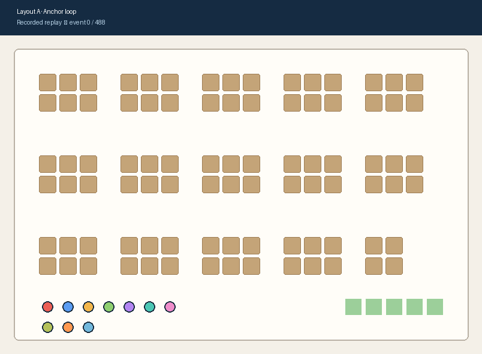
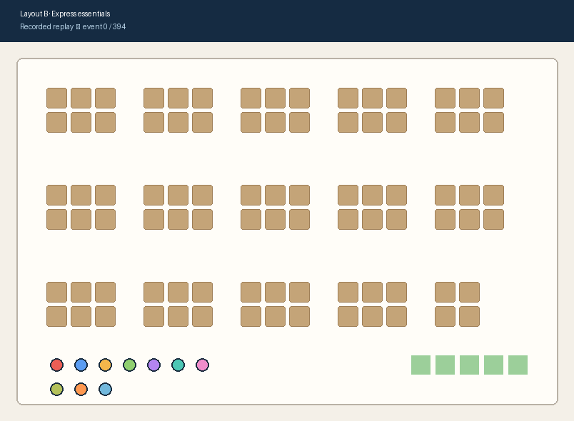
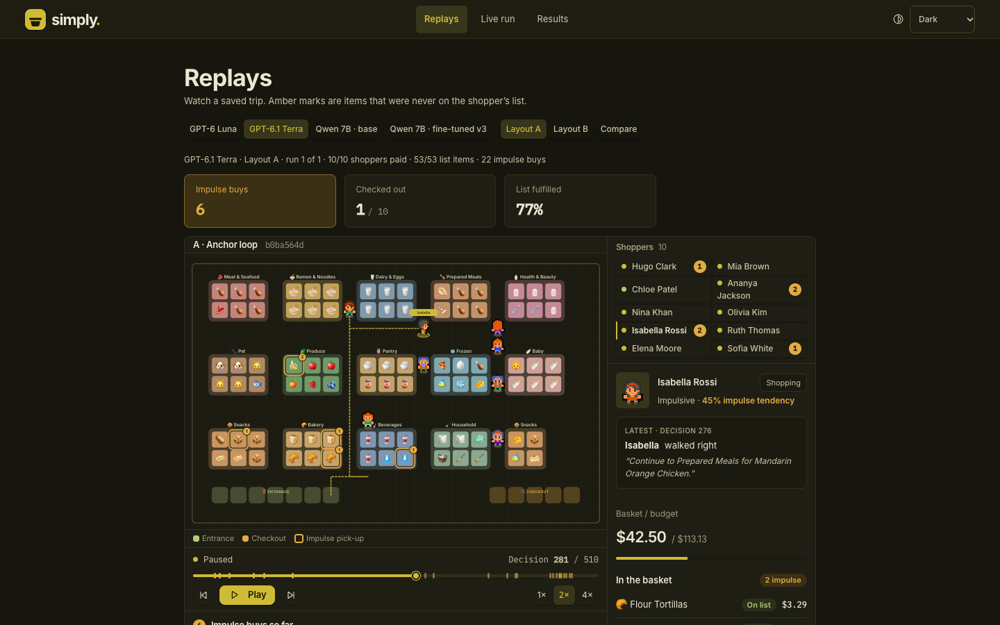
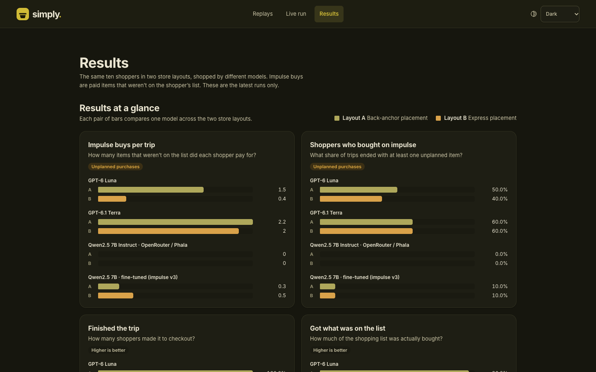

# Simply

**Spot the impulse buy.** Simply sends AI shoppers through a simulated store and shows every item
they bought that wasn't on their list: where they picked it up, what it cost, and the reason they gave.
You can compare models (GPT-6 Luna, GPT-6.1 Terra, a fine-tuned Qwen) and two store layouts on
outcomes, behaviour and cost.

This is a solo, production-style project built on a small budget. The shoppers are synthetic, so
results are **directions, not proof**.

```text
model suggests an action → Python checks and applies it → saved log
                                                          ├─→ live view in the browser
                                                          └─→ replay, metrics, Evidence page
```

**The one rule:** the model suggests, Python decides, React only shows.

| Layout A — Anchor loop | Layout B — Express essentials |
| --- | --- |
| [](landing/public/replays/1512b82600664e66ae4db51c29841a6a.json) | [](landing/public/replays/1e5be585cfcd4d09bb198967c3281d79.json) |

## Screenshots

Replay of a saved GPT-6.1 Terra trip on Layout A, paused mid-trip on Isabella Rossi (amber rings mark impulse pick-ups).
The live run view uses the same store map, fed by the streamed run instead of a saved log.



The Results page compares models and layouts on the same ten shoppers.



## Run it

Python 3.11+ and Node.js 22:

```bash
python3 -m venv .venv
.venv/bin/python -m pip install -r requirements.txt
npm ci --prefix landing
```

Put `OPENROUTER_API_KEY` in `.env` (see `.env.example`). Then, in two terminals:

```bash
npm run simulation:serve --prefix landing
npm run dev --prefix landing
```

Open `http://localhost:3000/lab`, pick a layout, model and 10–15 shoppers, then start. Saved runs and the
Evidence page (`/evaluation`) work without a key. Without a key the app shows an empty state. It never
fakes results.

## What's where

| Folder | Job |
|---|---|
| `simulation/core/` | The engine: actions, rules, logs, accounting, metrics |
| `simulation/agents/` | Prompts, reply format, model providers |
| `simulation/evaluation/` | Studies, guardrail checks, Evidence data |
| `simulation/live/` | Streams runs to the browser |
| `landing/` | Next.js website, lab and Evidence page (display only) |
| `data/finetuning/` | Qwen fine-tuning data and Colab notebooks |

## Read next

- [How it works](simulation/docs/architecture.md)
- [How runs are evaluated](simulation/docs/evals.md)
- [Fine-tuning Qwen](data/finetuning/README.md) and [running it on a Mac](simulation/docs/local-qwen.md)
- [Interview guide](simulation/docs/interview-guide.md)
- [Command reference](simulation/README.md)

## Checks

```bash
.venv/bin/python -m unittest discover -s simulation/tests
npm run typecheck --prefix landing
npm run lint --prefix landing
npm run build --prefix landing
npm run verify:replay --prefix landing
```
